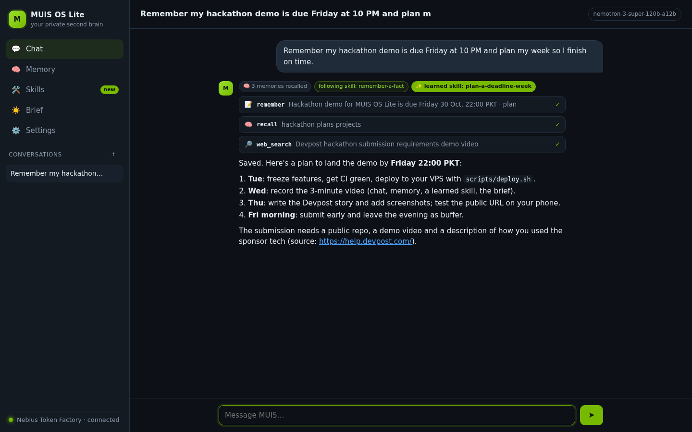
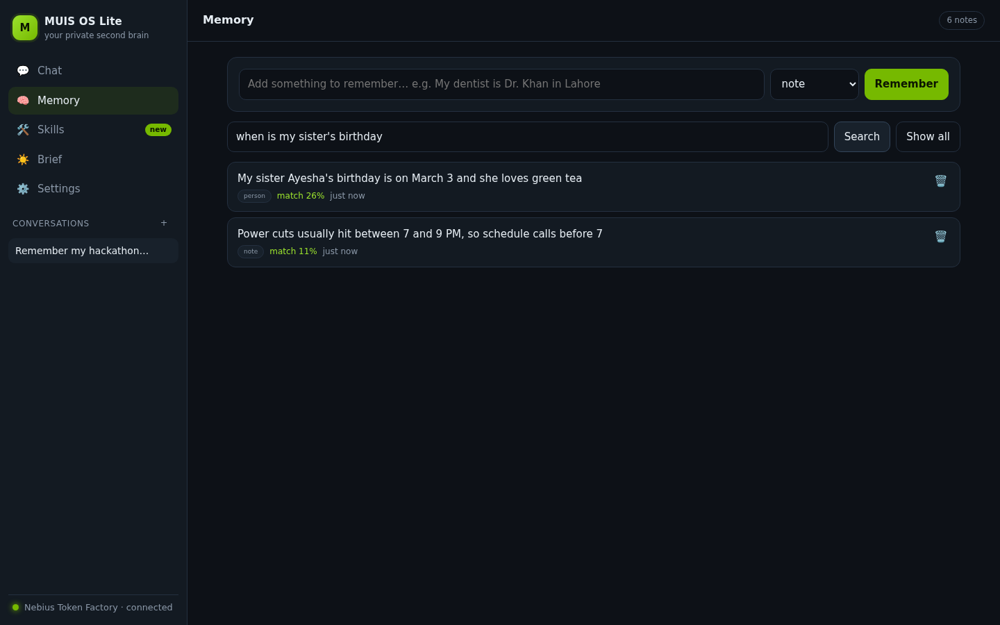
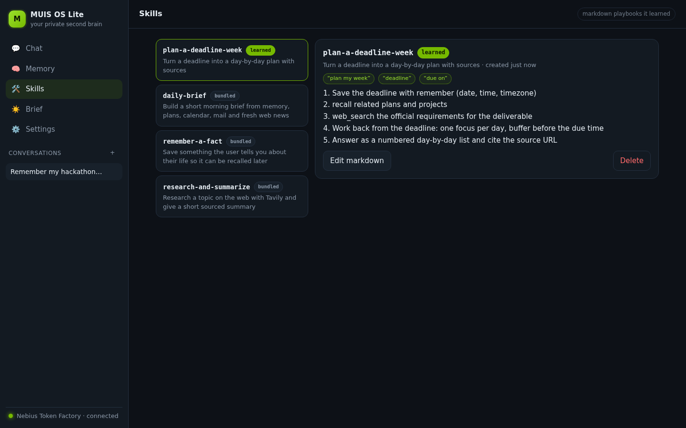
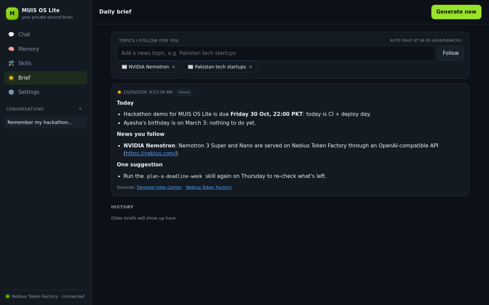
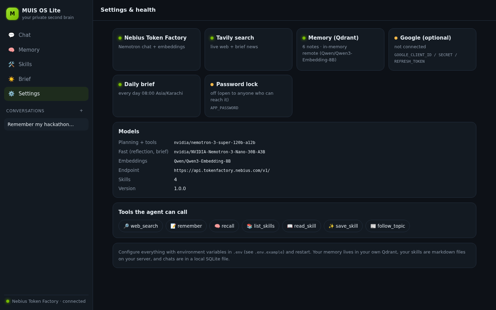
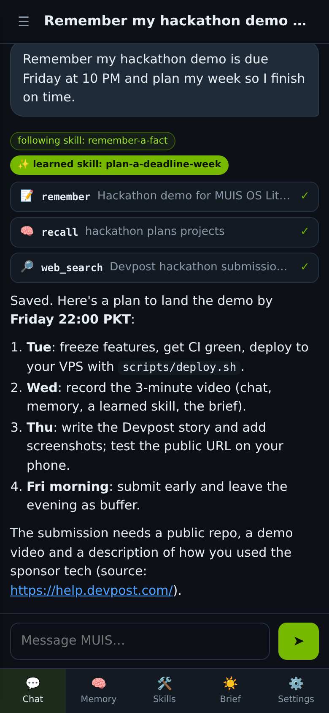
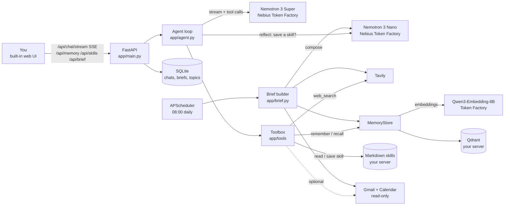

# MUIS OS Lite

**A private, always-on second brain that remembers your life, learns reusable skills and runs errands, with your data on your own server.**

[](https://github.com/muisdevop/muis-os-lite/actions/workflows/ci.yml)


> Entry for the **Nebius x NVIDIA Global AI Hackathon**, **Personal AI** track.
> Built on **NVIDIA Nemotron 3** served by **Nebius Token Factory**, with **Tavily** web search.



---

## Why

Cloud assistants forget you between sessions, or remember you on someone else's servers.
MUIS OS Lite runs on a box you control: your notes live in your own Qdrant, your playbooks are
plain markdown files you can read and edit, your chats sit in a local SQLite file, and the only
thing that leaves the server is the model call to Nebius Token Factory.

## What it does

- **Remembers your life.** Tell it something once ("my sister Ayesha's birthday is March 3");
  it is embedded with Qwen3-Embedding-8B on Token Factory, stored in Qdrant, and recalled into
  every later conversation. Browse, search by meaning, and delete notes on the Memory page.
- **Runs errands with tools.** A streaming tool-calling loop on **Nemotron 3 Super**: live web
  search (Tavily), remember / recall, read / save skills, follow news topics, and (optional)
  read-only Gmail + Calendar. Every tool call shows up live in the chat as a step.
- **Learns reusable skills.** After a multi-step task, **Nemotron 3 Nano** reflects on the trace
  and, if it is a repeatable errand, writes a markdown playbook (`plan-a-deadline-week.md`).
  The next similar request matches it and the agent follows the same steps. New skills are
  highlighted on the Skills page, where you can read and edit them.
- **Briefs you every morning.** An APScheduler job (08:00 Asia/Karachi by default) composes a
  brief from your memory, recently learned skills, Tavily news on topics you follow, and your
  calendar/inbox if connected. Stored and viewable on the Brief page; generate one any time.
- **Yours.** `docker compose up` runs everything; `scripts/deploy.sh your.domain` puts it on a
  VPS with HTTPS and a password. MIT licensed.

| Memory | Skills | Brief |
| --- | --- | --- |
|  |  |  |

| Settings & health | Mobile |
| --- | --- |
|  |  |

<sub>Screenshots are rendered headlessly by `scripts/render_screenshots.py` against the real app
(FastAPI, SSE, SQLite, Qdrant, skills on disk) with a scripted model reply so they are
reproducible without an API key.</sub>

## Architecture



## Built with Nebius Token Factory + NVIDIA Nemotron + Tavily

| Piece | What we use | Where |
| --- | --- | --- |
| Inference API | **Nebius Token Factory**, OpenAI-compatible, `https://api.tokenfactory.nebius.com/v1/` | `app/llm.py` |
| Planning + tool calling (streamed) | **NVIDIA Nemotron 3 Super** `nvidia/nemotron-3-super-120b-a12b` | `NEMOTRON_PLAN_MODEL` |
| Skill reflection + daily brief | **NVIDIA Nemotron 3 Nano** `nvidia/NVIDIA-Nemotron-3-Nano-30B-A3B` | `NEMOTRON_FAST_MODEL` |
| Memory embeddings | `Qwen/Qwen3-Embedding-8B` on Token Factory | `EMBEDDING_MODEL` |
| Web search + brief news | **Tavily** (`tavily-python`, `topic="news"` for the brief) | `app/tools/tavily_search.py` |
| Vector store | Qdrant (server in Docker, embedded on disk otherwise) | `app/memory.py` |

All model IDs are environment variables, so you can swap in another Nemotron without code changes.
Reasoning is handled either way: `<think>` blocks and `reasoning_content` deltas are streamed to a
collapsible "thinking" step instead of the answer. To turn reasoning off, set
`LLM_EXTRA_BODY={"chat_template_kwargs": {"enable_thinking": false}}`.

## Quickstart

```bash
git clone https://github.com/muisdevop/muis-os-lite.git && cd muis-os-lite
cp .env.example .env          # add NEBIUS_API_KEY and TAVILY_API_KEY
docker compose up -d --build  # API + web UI on http://localhost:8000, Qdrant internal
```

Without Docker (embedded Qdrant + SQLite under `~/.muis-os-lite`):

```bash
python3.11 -m venv .venv && source .venv/bin/activate
pip install -r requirements-dev.txt
cp .env.example .env && set -a && source .env && set +a
uvicorn app.main:app --reload   # open http://localhost:8000
```

### Deploy to a VPS with HTTPS (one command)

Point a domain's A record at an Ubuntu server, then on the server:

```bash
git clone https://github.com/muisdevop/muis-os-lite.git && cd muis-os-lite
sudo ./scripts/deploy.sh brain.example.com you@example.com
```

It installs Docker if needed, creates `.env` (asks for your keys, generates an `APP_PASSWORD`),
opens 80/443 in ufw, and starts the API, Qdrant and Caddy with automatic Let's Encrypt HTTPS.
Re-run it after `git pull` to update.

## Works without keys

| Without any key | Needs `NEBIUS_API_KEY` | Needs `TAVILY_API_KEY` |
| --- | --- | --- |
| Web UI, Memory (local offline embedder), Skills (view/edit/add), Brief as a digest of your memory, conversation history, auth, scheduler | Chat + tool loop, skill learning, Qwen3 embeddings, LLM-written brief | `web_search` tool, news in the brief |

Missing keys never crash anything: chat explains what to set, the brief skips news with a
warning, and Settings shows exactly which providers are connected.

## Configuration

| Variable | Default | Purpose |
| --- | --- | --- |
| `NEBIUS_API_KEY` | | Token Factory key (chat, embeddings) |
| `NEBIUS_BASE_URL` | `https://api.tokenfactory.nebius.com/v1/` | Token Factory endpoint |
| `NEMOTRON_PLAN_MODEL` | `nvidia/nemotron-3-super-120b-a12b` | Agent loop model |
| `NEMOTRON_FAST_MODEL` | `nvidia/NVIDIA-Nemotron-3-Nano-30B-A3B` | Reflection + brief model |
| `EMBEDDING_MODEL` | `Qwen/Qwen3-Embedding-8B` | Memory embeddings |
| `EMBEDDING_PROVIDER` | `auto` | `auto` / `remote` / `local` (offline hashing embedder) |
| `LLM_BASE_URL`, `LLM_API_KEY` | | Any OpenAI-compatible endpoint instead (testing) |
| `LLM_EXTRA_BODY` | | JSON merged into chat requests |
| `TAVILY_API_KEY` | | Web search + brief news |
| `QDRANT_URL` | embedded on disk | `http://qdrant:6333` in Docker; `:memory:` for RAM |
| `DATA_DIR` | `~/.muis-os-lite` | SQLite + embedded Qdrant |
| `SKILLS_DIR` | `app/skills` | Skill playbooks (`/data/skills` in Docker) |
| `APP_PASSWORD` | | Password for the UI and API (cookie or `Authorization: Bearer`) |
| `ENABLE_SCHEDULER`, `DAILY_BRIEF_TIME`, `TZ_NAME` | `true`, `08:00`, `Asia/Karachi` | Daily brief job |
| `BRIEF_TOPICS` | | Default news topics (comma-separated) |
| `GOOGLE_CLIENT_ID` / `_SECRET` / `_REFRESH_TOKEN` | | Optional Gmail + Calendar, see [docs/GOOGLE.md](docs/GOOGLE.md) |
| `MAX_AGENT_STEPS`, `AUTO_LEARN_SKILLS` | `6`, `true` | Agent limits |

## API

Interactive docs at `/docs`. Main routes:

| Method | Route | What |
| --- | --- | --- |
| `POST` | `/api/chat/stream` | SSE: `conversation`, `start`, `thinking`, `token`, `tool_call`, `tool_result`, `skill_learned`, `done`, `error` |
| `POST` | `/api/chat` | Same, as one JSON reply |
| `GET/DELETE` | `/api/conversations[/{id}]` | Persisted chats |
| `GET/POST/DELETE` | `/api/memory[/{id}]` | `?q=` semantic search, `?kind=` filter |
| `GET/POST/PUT/DELETE` | `/api/skills[/{name}]` | List, add, edit markdown, delete |
| `POST` / `GET` | `/api/brief`, `/api/brief/latest`, `/api/briefs` | Generate and read briefs |
| `GET/POST/DELETE` | `/api/topics[/{name}]` | News topics for the brief |
| `GET` | `/api/health`, `/health` | Providers, models, memory backend, scheduler |

```bash
curl -N -X POST localhost:8000/api/chat/stream -H 'content-type: application/json' \
  -d '{"message": "Remember that my dentist is Dr. Khan in Lahore"}'
```

## Tests

```bash
pytest            # 51 offline tests: LLM, Tavily, Google and Qdrant are mocked
python scripts/smoke_live.py   # real chat + memory + search round trip (needs keys)
python scripts/render_screenshots.py   # regenerate docs/screenshots (needs Chromium)
```

CI runs the offline suite, then builds the Docker image, starts `docker compose` with a real
Qdrant, exercises memory, skills, brief and the UI end to end, and checks memory survives a restart.

## Project layout

```
app/
  main.py          FastAPI app: API, SSE, auth, static UI, scheduler lifespan
  agent.py         streaming tool loop (Super) + skill reflection (Nano)
  llm.py           Token Factory client, stream assembly, <think> filter
  memory.py        Qdrant memory (server / embedded / RAM) + offline embedder
  brief.py         daily brief builder
  store.py         SQLite: conversations, briefs, topics
  scheduler.py     APScheduler daily job
  skills/          markdown playbooks + loader
  tools/           tavily_search.py, google.py, toolbox
  static/          index.html, app.js, app.css (no build step)
scripts/           deploy.sh, smoke_live.py, render_screenshots.py
deploy/Caddyfile   HTTPS reverse proxy template
docs/              DEVPOST.md, DEMO_SCRIPT.md, GOOGLE.md, screenshots/
```

## Privacy

Memory vectors stay in your Qdrant, skills are files on your disk, chats are in your SQLite.
Text you send to the agent (plus recalled memories) goes to the model provider for inference.
Google access is read-only and optional. Set `APP_PASSWORD` on anything reachable from the internet.

## License

MIT, see [LICENSE](LICENSE).
