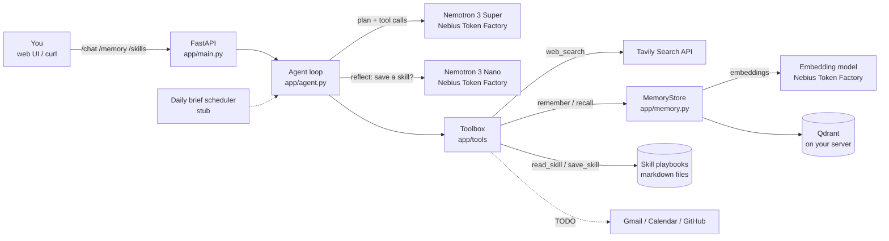

# MUIS OS Lite

**A private, always-on second brain that remembers your life, learns reusable skills and runs errands, with your data on your own server.**

[](.github/workflows/ci.yml)


> Entry for the **Nebius x NVIDIA Global AI Hackathon**, **Personal AI** track.

---

## Why

Cloud assistants forget you between sessions, or remember you on someone else's servers.
MUIS OS Lite runs on a box you control: your notes live in your own Qdrant, your playbooks
are plain markdown files you can read and edit, and the only thing that leaves the server is
the model call to Nebius Token Factory.

## Features

- **Remembers your life**: notes are embedded with a Token Factory embedding model and stored in
  Qdrant; relevant memories are recalled into every conversation.
- **Learns reusable skills**: after a multi-step task, Nemotron Nano reflects and saves a markdown
  playbook (`app/skills/*.md`) that is matched and followed next time. You can also add skills by API.
- **Runs errands with tools**: a tool-calling loop on Nemotron Super with live web search (Tavily),
  memory read/write and skill read/write. Gmail, Calendar and GitHub hooks are stubbed for next.
- **Daily brief** (stub): a scheduled morning brief built from memory and fresh news.
- **Your server, your data**: `docker compose up` runs the API and Qdrant together. MIT licensed.

## Architecture



## Built with Nebius Token Factory + NVIDIA Nemotron + Tavily

| Piece | What we use | Where |
| --- | --- | --- |
| Inference API | **Nebius Token Factory**, OpenAI-compatible, base URL `https://api.tokenfactory.nebius.com/v1/` | `app/llm.py` |
| Planning + tool calling | **NVIDIA Nemotron 3 Super** `nvidia/nemotron-3-super-120b-a12b` | `NEMOTRON_PLAN_MODEL` |
| Fast calls (skill reflection) | **NVIDIA Nemotron 3 Nano** `nvidia/NVIDIA-Nemotron-3-Nano-30B-A3B` | `NEMOTRON_FAST_MODEL` |
| Memory embeddings | Token Factory embedding model, default `Qwen/Qwen3-Embedding-8B` | `EMBEDDING_MODEL` |
| Web search | **Tavily** via `tavily-python` | `app/tools/tavily_search.py` |
| Vector store | Qdrant via `qdrant-client` | `app/memory.py` |

All model IDs are set by environment variables, so you can swap in another Nemotron
(for example `nvidia/Nemotron-3_5-Lightning` or `nvidia/Nemotron-3-Ultra-550b-a55b`) without code changes.
Check the live list with `GET https://api.tokenfactory.nebius.com/v1/models`.

## Quickstart

```bash
git clone https://github.com/OWNER/muis-os-lite.git && cd muis-os-lite
cp .env.example .env          # add NEBIUS_API_KEY and TAVILY_API_KEY
docker compose up --build     # API on :8000, Qdrant on :6333
```

Without Docker (in-process Qdrant, nothing persisted):

```bash
python3.11 -m venv .venv && source .venv/bin/activate
pip install -r requirements-dev.txt
cp .env.example .env && set -a && source .env && set +a
uvicorn app.main:app --reload
```

Try it:

```bash
curl localhost:8000/health
curl -X POST localhost:8000/memory -H 'content-type: application/json' \
  -d '{"text": "My hackathon entry is due Oct 30 at 22:00 PKT", "kind": "plan"}'
curl -X POST localhost:8000/chat -H 'content-type: application/json' \
  -d '{"message": "What is due this month, and what is new with NVIDIA Nemotron?"}'
curl localhost:8000/skills
```

Interactive API docs: <http://localhost:8000/docs>

### API

| Method | Path | Does |
| --- | --- | --- |
| GET | `/health` | Status, configured models, base URL, tools |
| POST | `/chat` | `{message, history?}` -> `{reply, tool_calls, memories_used, skill_saved}` |
| POST | `/memory` | Save a note `{text, kind?, tags?}` |
| GET | `/memory?q=...&k=5` | Recall by meaning (or recent notes without `q`) |
| GET | `/skills`, `/skills/{name}` | List or read playbooks |
| POST | `/skills` | Save a playbook `{name, description, steps[], triggers?}` |

## Demo story

1. **Monday**: "Remember my sister Ayesha's birthday is March 3 and she loves books."
   The agent calls `remember`; the note goes into Qdrant on my server.
2. **Tuesday**: "Find three well-reviewed new novels under $20 for Ayesha and compare them."
   Nemotron Super recalls Ayesha's note, runs two Tavily searches, and answers with sources.
   Because it took several tool calls, Nemotron Nano reflects and saves a new skill,
   `gift-for-a-person.md`.
3. **Late February**: "Gift ideas for Ayesha?" The saved skill is matched and followed step by step,
   so the answer is faster and more consistent. The playbook is a plain file I can edit.
4. **Every morning** (next): the daily brief pulls plans from memory plus fresh news.

## Project layout

```
app/
  main.py            FastAPI app: /chat /memory /skills /health
  agent.py           tool-calling loop + skill learning
  llm.py             OpenAI SDK -> Nebius Token Factory (Nano / Super / embeddings)
  memory.py          Qdrant memory store
  config.py          env settings
  scheduler.py       daily brief (stub)
  skills/            markdown playbooks + loader.py
  tools/             tavily_search.py, toolbox, integrations.py (Gmail/Calendar/GitHub TODO)
tests/               offline pytest suite (all external APIs mocked)
web/                 Next.js chat UI (placeholder)
```

## Tests

```bash
pip install -r requirements-dev.txt
pytest
```

The suite runs fully offline: the OpenAI client, Tavily and embeddings are faked and Qdrant runs in memory.

## Roadmap

- [ ] Gmail, Calendar and GitHub tools (OAuth)
- [ ] Daily brief scheduler + delivery (email / Telegram)
- [ ] Next.js chat UI in `web/`
- [ ] Per-user auth for the API

## Hackathon

- **Event**: Nebius x NVIDIA Global AI Hackathon
- **Track**: Personal AI
- **Stack requirement**: runs on Nebius Token Factory with NVIDIA Nemotron open models; uses Tavily for search.

## License

[MIT](LICENSE) © 2026 Muhammad Usama Intezar
